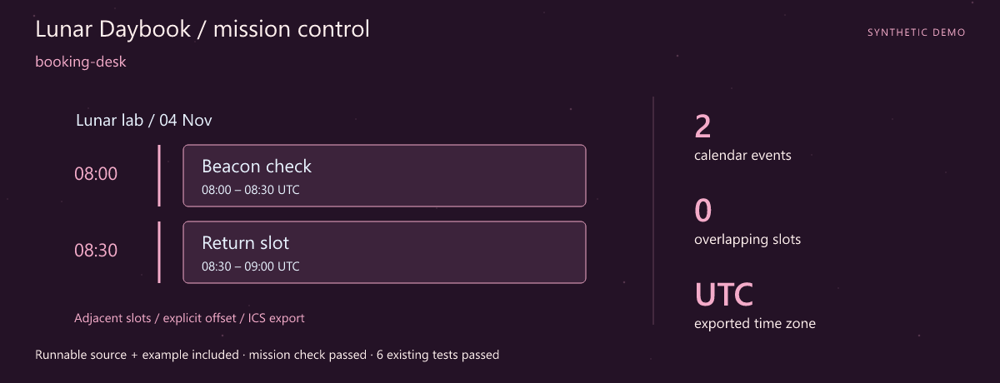
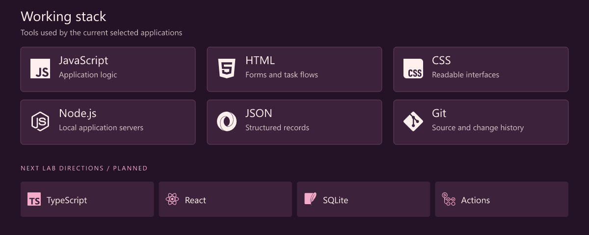
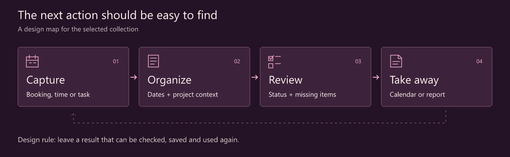
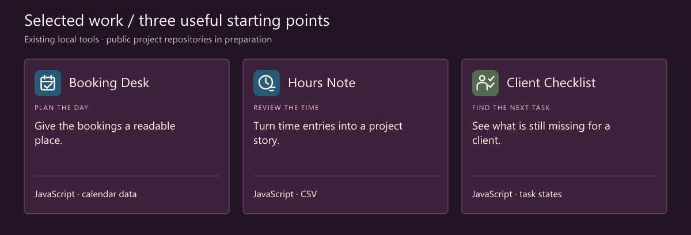

# Julia · Web Developer · Everyday Business Tools

> **Lunar Daybook** · A calmer orbit for the working day.

**A clear next action for the work between the appointments.**

[Download the runnable mission](src/assets/launch.zip) · [Launch guide](src/LAUNCH.md) · [Working stack](#working-stack) · [Selected work](#selected-work)

## Mission control



**First launch: booking-desk.** A complete source snapshot, synthetic example and assertion script are included. The mission check and **6 existing tests** passed. [Try the mission](src/LAUNCH.md) · [Snapshot and checked result](src/assets/launch.json).

I'm Julia. This collection is about useful little web applications: reviewing a booking, turning time entries into a project report, seeing what is still missing from a client checklist.

A good small tool helps someone finish a task and take away an understandable result. The details I care about are readable forms, visible status and exports that are easy to review.

## What I focus on

- **Small-business workflows.** Appointments, time reports and onboarding tasks deserve a clear place.
- **Forms and state.** Make required inputs, progress and the next action visible.
- **Useful outputs.** An export or report should still make sense after the browser tab is closed.

## Working stack



The upper panel shows technologies used by the selected tools. The lower row is the next lab track.

## How I think about the work



## Selected work

Three existing local tools form this curated collection. Their public project repositories are being prepared.



| Project / stack | Why it belongs here | Input → output |
| --- | --- | --- |
| **Booking Desk**<br>JavaScript · calendar data | Give the bookings a readable place. Review a local booking board and export calendar entries. | **In:** Resources + booking times<br>**Out:** A booking board + calendar export |
| **Hours Note**<br>JavaScript · CSV | Turn time entries into a project story. Prepare a project time report from recorded entries and breaks. | **In:** Project time entries<br>**Out:** A project time report |
| **Client Checklist**<br>JavaScript · task states | See what is still missing for a client. Review onboarding tasks, document requirements, statuses and due dates. | **In:** Client task records<br>**Out:** An onboarding checklist |

### One ordinary entry, ready to review

```csv
project,date,start,end,break
Example project,2026-11-04,09:00,10:30,10
```

Synthetic time-report input. A start, an end and an explicit break keep the calculation inspectable.

## Code and activity


These charts record one successful daily statistics snapshot after the workflow is enabled. Four attempts per day provide retries. Snapshot commits are labelled automated and authored by the profile owner using a verified GitHub noreply identity, with github-actions[bot] as committer. Owner contribution attribution follows GitHub rules; repository charts still include all authors. The observation time is printed on every chart. Commits are unique default-branch SHAs across all authors and owned public repositories, including forks. Language bytes describe repositories, not personal skill. Public interactions are a limited event feed (up to 300 events / 30 days), not visitor analytics. API and image caches may delay updates.

[Live data and scope](https://julia259.github.io/julia259/src/assets/live/metrics.json) · [Portfolio website](https://julia259.github.io/julia259/) · [Refresh setup](src/SETUP.md)

## Next lab

1. **Edit with confidence.** Make changes to saved records easier to review.
2. **Give dates more context.** Clarify due dates, booking times and incomplete tasks.
3. **Improve the handoff.** Explore typed records and more comfortable report exports.

## Start a conversation

A form that needs a clearer next step, a confusing report or a small administrative workflow is a good subject for a practical example.

[Open the profile repository's issues](https://github.com/julia259/julia259/issues) · [Browse the repositories](https://github.com/julia259?tab=repositories)

> 🌱 A fresh workspace for useful web tools.

---

<sub>Fictional developer persona · AI-illustrated avatar. Curated tools retain original authors, licenses and commit history. Technology icons: Simple Icons.</sub>

[Artwork and data notes](src/assets/NOTICE.md)
